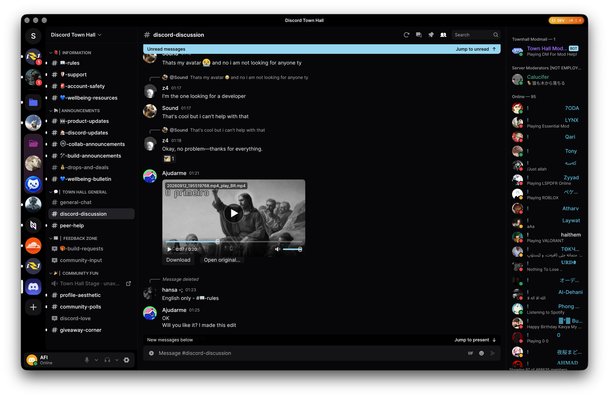
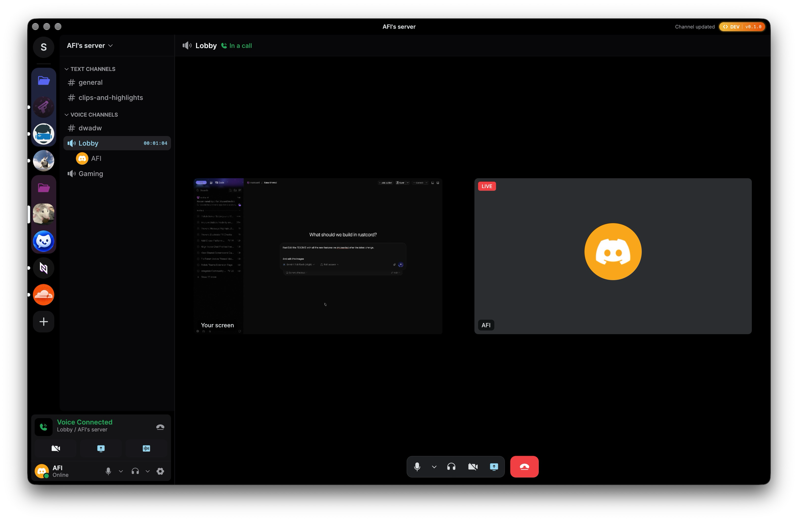
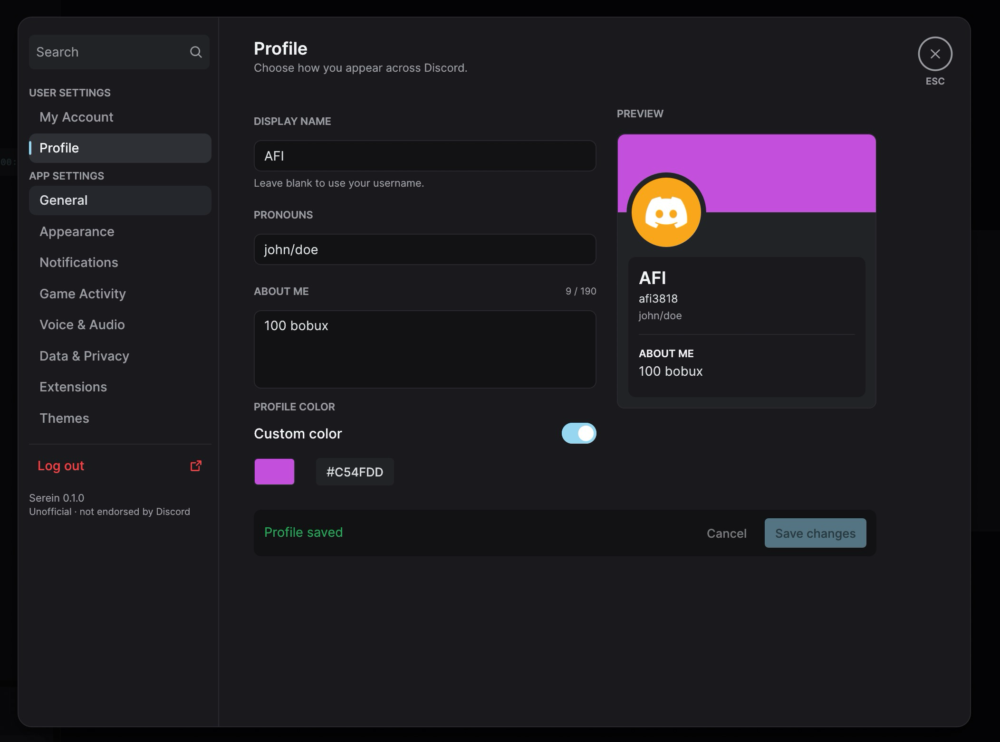
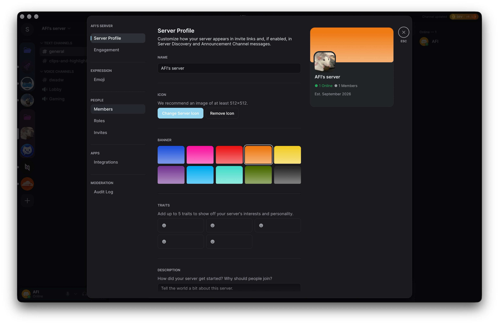
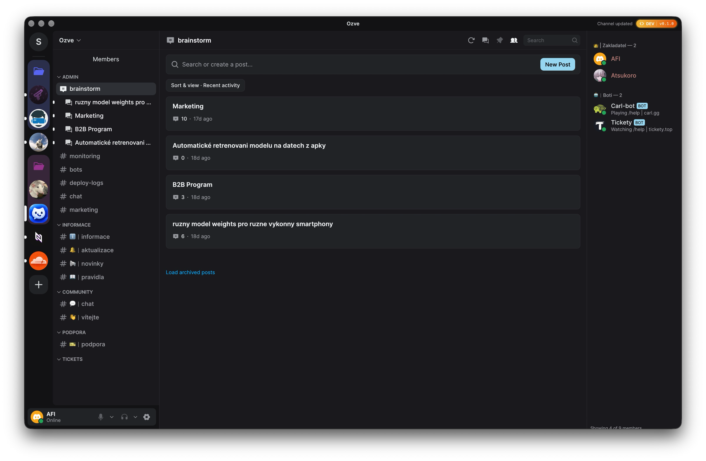
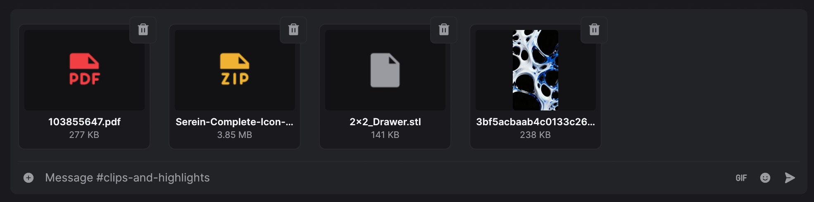
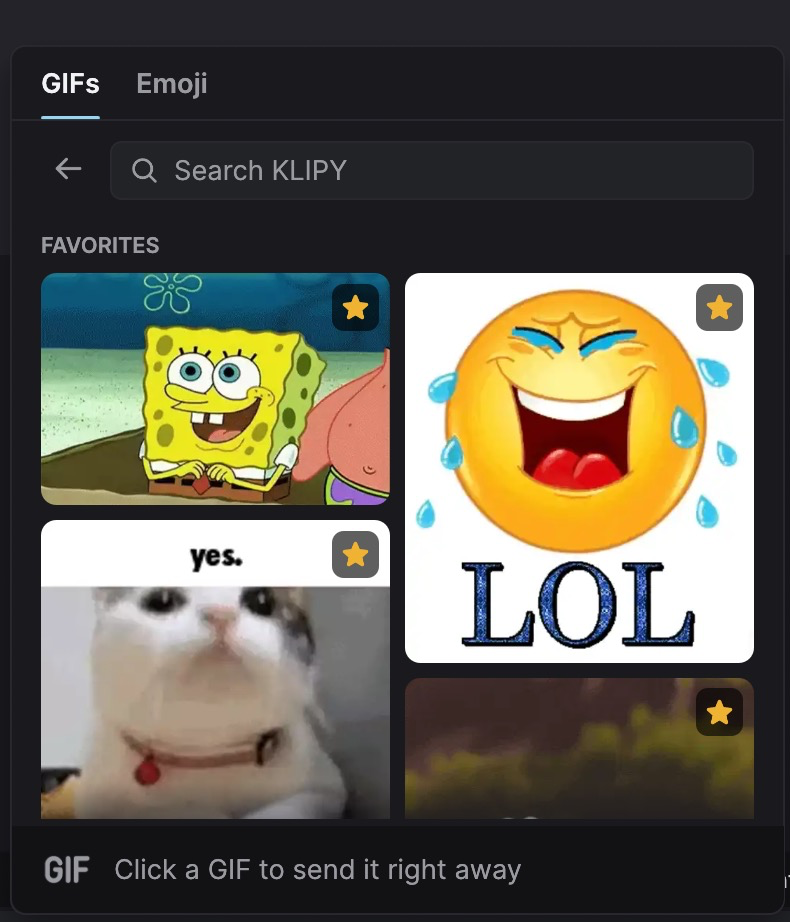
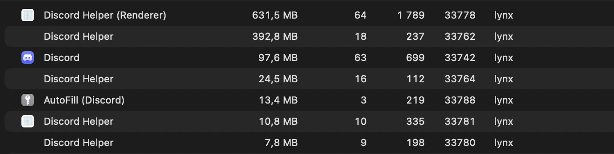
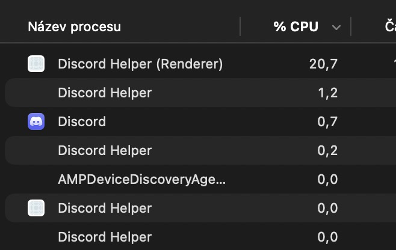

# Evita

<p align="center">
  <a href="https://github.com/tsukumivi/Evita">
    
  </a>
</p>

<p align="center">
  <strong>A lightweight, native Discord desktop client written in Rust, powered by egui and wgpu.</strong>
</p>

<p align="center">
  <a href="#downloads--installation"><strong>📦 Downloads</strong></a> &nbsp;•&nbsp;
  <a href="#highlights"><strong>⚡ Highlights</strong></a> &nbsp;•&nbsp;
  <a href="#feature-showcase"><strong>✨ Showcase</strong></a> &nbsp;•&nbsp;
  <a href="#measured-performance-vs-official-discord"><strong>📊 Benchmarks</strong></a> &nbsp;•&nbsp;
  <a href="#quick-start"><strong>🛠️ Quick Start</strong></a> &nbsp;•&nbsp;
  <a href="#feature-matrix"><strong>📋 Features</strong></a> &nbsp;•&nbsp;
  <a href="#architecture-overview"><strong>🏗️ Architecture</strong></a>
</p>

<p align="center">
  <a href="https://github.com/tsukumivi/Evita/releases/latest"></a>
  <a href="Cargo.toml"></a>
  <a href="crates/ui"></a>
  <a href="docs/platform-support.md"></a>
  <a href="LICENSE-MIT"></a>
</p>

---

> [!WARNING]
> **Unofficial and not endorsed by Discord.**
> Evita communicates directly with Discord's public gateway and REST endpoints for your existing account. Automating normal accounts outside the official OAuth2/bot API violates Discord's Terms of Service and carries risk of account termination. Technical interoperability does not imply platform approval. Review the [compatibility matrix](docs/discord-compatibility.md) and [authentication guide](docs/authentication.md) before use.

---

## Downloads & Installation

Evita's current installers are available on the [latest GitHub release](https://github.com/tsukumivi/Evita/releases/latest). In-app automatic updates are not configured yet; to update, download and run the newer release installer.

### Install on Windows

1. Open the [latest release](https://github.com/tsukumivi/Evita/releases/latest) and download `Windows-X64-Setup.exe` for Intel/AMD Windows, or `Windows-ARM64-Setup.exe` for Windows on ARM.
2. Run the downloaded installer and follow the setup prompts.
3. Evita installs for your Windows user; administrator access is not required.

The installer is not code-signed, so Windows may show a security warning.

### Build from source

To rebuild the installer, install Rust 1.98.1 with the MSVC toolchain, Visual Studio C++ Build Tools, and NSIS, then run this command from the repository:

```powershell
cargo xtask package
```

The build places the Windows app and its required runtime files in `dist/` and, when `makensis` is available, creates a versioned setup file in `dist-installer/` (for example, `evita-1.0.0-setup.exe`). Run that setup file to install Evita for the current Windows user without administrator access. For a portable copy, keep the full `dist/` folder together so `WebView2Loader.dll` and any toolchain import alias remain beside `evita.exe`.

For a development launch, use `cargo run --locked`. The demo command uses only synthetic data: `cargo run --locked --features demo -- --demo`.

### Using Evita with Yozora

[Yozora](https://github.com/mariyaholic/yozora), maintained by Maria, publishes music and video Rich Presence over the standard Discord local IPC protocol. Evita implements that protocol. Start Evita and sign in, then open **Settings → Registered Games** and enable **Share activity**. Close the official Discord client while using Yozora with Evita: Yozora connects to the first available Discord IPC pipe, so an already running official client would receive the presence instead. Start Yozora in the same Windows user session and choose the media sources you want in its control panel. Evita displays Yozora activity text, timestamps, and approved artwork. Evita filters external presence buttons and party actions. Local activity is accepted only while sharing is enabled and the account is connected; disabling sharing closes Evita's IPC listener.

### Yozora appearance themes

Evita also includes the 11 named palettes from [Yozora's Appearance picker](https://github.com/mariyaholic/yozora#appearance). Choose one under **Settings → Appearance → Color preset**. Night Sky, Uika, Pine, Kurisu, Ava, Astra, and Mariyaholic-98 use their dark palettes; Sumimi, Ledger, Confluence, and Astra Light use their light palettes. Choosing one selects its matching appearance mode and keeps its palette accent. Evita's existing presets remain available as well. The palette colors are adapted to Evita's native app surfaces; Yozora's browser-panel fonts and motion effects are specific to Yozora.

---

### Other platforms

macOS and Linux downloads are also available on the [latest GitHub release](https://github.com/tsukumivi/Evita/releases/latest). The current release includes a macOS ARM64 archive and Linux packages for AppImage, Flatpak, Arch, Ubuntu/Debian, Fedora, and openSUSE.

---

## Highlights

- ⚡ **Pure Native Performance:** Built with pure Rust, `egui`, and `wgpu`. Immediate-mode rendering with minimal idle CPU, low memory footprint, and instantaneous launch times—zero Electron, Node.js, or web runtime overhead.
- 🌐 **Direct Gateway & REST Transports:** Direct connection to Discord's official endpoints with active rate-limiting cooldowns, heartbeat handling, reconnect/resume loops, and partial payload patching.
- 🔒 **Secure OS Credential Storage:** Session tokens use your operating system's secure vault by default (macOS Keychain, Windows Credential Manager, or Linux Secret Service). Settings › Storage offers an explicit, unencrypted plaintext fallback when the keyring does not work.
- 🛡️ **Ephemeral Authentication Webview:** Sign-in uses Discord's official hosted login page inside a temporary native webview (WKWebView, WebView2, or WebKitGTK) supporting email/password, QR login, and MFA. An origin-checked handoff secures the session credential and immediately terminates the webview.
- 💾 **Bounded Local Persistence:** Recent chat history, drafts, image previews, settings, and diagnostics are stored in an account-isolated, bounded local SQLite database. All local data is strictly cleared upon explicit logout.
- 🎙️ **Voice Calls, Video & Screen Sharing:** Complete native voice engine with 1-to-1 and group DM calls, server voice channels, push-to-talk, Sonora AEC3 acoustic echo cancellation, RNNoise noise suppression, Opus codec, and DAVE v1 end-to-end encryption. Includes native screen capture (macOS ScreenCaptureKit, Windows Graphics Capture, Linux portal/PipeWire with VA-API/NVENC hardware encoding and software fallback; Linux native capture remains unverified) and incoming stream & camera video playback with hardware-accelerated decoding (VideoToolbox, VA-API, DirectX).
- 🧵 **Forum Channels & Active Threads:** Browse forum channels, view posts sorted by recent activity, read message threads with unread indicators, and create new forum posts directly in-app.
- ⚙️ **Server Administration Suite:** Full server management interface including Server Profiles (banners, icons, traits, descriptions), custom sticker management, role editor with fine-grained permission matrix, paginated audit logs with action filters, invite manager with revocation, integrations and webhooks, and member moderation.
- ✨ **GIF & Twemoji Picker:** Instant KLIPY GIF search with favorites and one-click sending, full Twemoji picker with search and quick-reactions, plus custom guild emojis.
- 📎 **Multi-Attachment Batch Uploads:** Composer staging tray supporting multiple files of any type (PDF, ZIP, 3D STL, videos, audio, images) with file-type badges, thumbnails, size indicators, individual removal, and progress tracking.
- 👤 **Native Profile Customization:** In-app profile editor for global display names, bios / about me, pronouns, and custom accent colors with real-time live preview cards.
- 🎨 **Extensions & Theme Shop:** Git-backed plugin engine and community theme shop with preview cards, color preset toggles, permission verification, and a built-in deleted-message retention protector.
- 🎬 **Rich Media & Video Player:** Inline video playback for MOV, MP4, and WebM attachments where platform codecs are available, interactive seekable voice message waveforms, right-click media save/copy context menus, and full-resolution image viewer modals.
- ⌨️ **Keybinds & Shortcuts:** Built-in keybind reference sheet styled with raised keycaps, quick edit (`Up`), quick delete (`Backspace`), and intuitive keyboard navigation.
- 🎮 **Rich Presence & Game Detection:** Built-in Discord IPC and WebSocket RPC servers, plus executable-based detection of running games, showing live game activities in member rosters, DM lists, and user profiles, with opt-in system tray integration.

---

## Feature Showcase

| Voice Calls & Live Screen Sharing | User Settings & Profile Customizer |
| :---: | :---: |
|  |  |
| **Server Administration & Profiles** | **Threads & Forum Channels** |
|  |  |
| **Multi-File Attachment Uploads** | **GIFs & Twemoji Picker** |
|  |  |

---

## Measured Performance vs. Official Discord

> **Testing Scenario:** Browsing channels while joined in a Voice Channel (VC) and streaming screen at 60 FPS on macOS.

| Metric | Official Discord Client (Electron) | Evita (Native Rust + egui/wgpu) | Advantage |
|---|:---:|:---:|:---:|
| **Memory (RAM)** | **1,178.4 MB** *(across 7 helper processes)* | **129.7 MB** *(single unified process)* | **~9× less memory (-89%)** |
| **CPU Usage** | **22.8%** *(Renderer + Helper processes)* | **8.1%** | **~2.8× lower CPU (-64%)** |

| Official Discord (Electron) | Evita (Native Rust) |
| :---: | :---: |
| **RAM: ~1,178.4 MB across 7 processes** | **RAM: 129.7 MB single process** |
|  |  |
| **CPU: 22.8% total** | **CPU: 8.1% total** |
|  |  |

---

## Quick Start

### Prerequisites
Rust **1.98.1** is pinned. Ensure you have the standard C/C++ toolchain and CMake installed for your platform:
- **macOS:** Xcode command-line tools (`xcode-select --install`)
- **Linux:** GCC/Clang, ALSA development headers, `pkg-config`, GTK 4, WebKitGTK 6.0, fontconfig, and Vulkan drivers (see [Platform Support](docs/platform-support.md))
- **Windows:** Visual Studio C++ build tools and WebView2 Runtime

### Running Locally

```sh
# 1. Run synthetic conversations; extension browsing uses public GitHub downloads
cargo run --locked --features demo -- --demo

# 2. Launch standard client with voice (uses saved login or official webview)
cargo run --locked
```

Default source builds keep SQLite, image caches, extensions and game metadata in the OS-local
`evita-development` directory, isolated from installed Evita data and safe from `cargo clean`.
Set `EVITA_DATA_DIR` to another absolute path when development copies need separate data roots;
packaged builds use the normal `evita` directory when the variable is absent. Login tokens remain
in the operating-system credential store under separate development and packaged-build entries.

### Workspace Commands

```sh
# Run full workspace validation (formatting, Clippy, tests, policy checks)
cargo xtask check

# Run release reducer benchmark
cargo replay

# Run authentication bridge JS test harness
node tests/login-handoff.cjs

# Package release including voice (macOS .app bundle, Linux .deb by default)
cargo xtask package
```

---

## Feature Matrix

| Capability | Status | Notes |
|---|---|---|
| **Navigation & Guilds** | Implemented | Collapsible categories, cached icons, guild channels, forum channels, active threads, DM lists, People pane, and server channel context menus |
| **Message Timeline** | Implemented | Virtualized variable-height rows, inline link confirmations, spoiler text/media reveal, unread message banners, deleted message protector, and local timezone timestamps |
| **Markdown & System Messages** | Implemented | Bold, italics, code blocks, blockquotes, clickable links, and styled system events with tinted Phosphor icons and clickable member names |
| **Reactions & Emojis** | Implemented | Twemoji rendering, native reaction counts, eight-emoji quick picker, full emoji picker integration, custom guild emojis, and add/remove reaction controls |
| **GIFs & Media Search** | Implemented | KLIPY GIF picker with search, favorites category, and one-click direct sending |
| **User Mentions & Autocomplete** | Implemented | Clickable user mentions with interactive composer autocompletion and visual highlight styling |
| **Media Previews & Video Player** | Implemented | Inline MOV, MP4, and WebM playback where platform codecs are available; media copy/save context menus, inline image cards, embed cards, related embed image galleries, and full-resolution image viewer modals |
| **File & Attachment Uploads** | Implemented | Multi-attachment batch staging with file-type badges (PDF, ZIP, STL, images), thumbnail previews, individual file removal, upload progress bar, and drag-and-drop |
| **Voice Engine & Calls** | Implemented | 1-to-1/group DM calls & server channels, Opus codec, DAVE v1 E2EE, Sonora AEC3 acoustic echo cancellation, RNNoise suppression, push-to-talk (`V`), audio device selector |
| **Voice Messages** | Implemented | Inline voice message playback with interactive waveforms and bounded streaming audio buffering |
| **Screen Sharing & Video** | Implemented | Native screen capture (macOS ScreenCaptureKit, Windows Graphics Capture, Linux portal/PipeWire with VA-API/NVENC hardware encoding and software fallback; Linux native capture remains unverified), quality presets (480p/720p/1080p/1440p/2160p, up to 60fps), and local camera/screen previews |
| **Camera Video & Stream Viewing** | Implemented | Hardware-accelerated decoding (macOS VideoToolbox, Linux VA-API, Windows DXVA/D3D11) for incoming screen streams and camera video feeds |
| **Threads & Forum Channels** | Implemented | Forum post listing, recent activity sorting, active thread browsing, and new forum post / thread creation |
| **Server Administration** | Implemented | Server profile editor (banners, icons, traits), custom sticker upload/edit/delete, role management with permissions matrix, audit log viewer, invite tracking and revocation, integrations/webhooks, and member moderation |
| **Extensions & Theme Shop** | Implemented | Git-backed plugins, community theme catalog with preview cards and color presets, permission prompt modals, and deleted-message protector |
| **Keybinds & Shortcuts** | Implemented | In-app keybind cheat sheet with raised keycaps, quick edit (`Up`), quick delete (`Backspace`), and keyboard navigation hotkeys |
| **Rich Presence & Game IPC** | Implemented | Discord IPC and WebSocket RPC servers plus running-game detection; displays activities in member rosters, DMs, and user profiles; opt-in system tray |
| **Profile Cards & Editing** | Implemented | On-demand profile popouts with banners, bios, badges, connections; native in-app editor for display name, bio, pronouns, and custom accent color with live preview |
| **Server & Group Actions** | Implemented | Server dropdown with friend invites and leave server; group DM actions (edit name/icon preview, mute, leave) |
| **Context Menus & Shortcuts** | Implemented | Right-click context menus for messages, media (save/copy), server channels, and members |
| **Typing Indicators** | Implemented | Displays incoming typing with short expiry; Evita strictly avoids emitting outgoing typing signals |
| **Persistence & Drafts** | Implemented | Bounded SQLite cache for history, drafts, settings, and diagnostics; OS credential store for auth tokens; sanitary logout |
| **Internationalization** | Partial | Bundled Inter font, CJK and Arabic font fallbacks included; full IME and bidirectional editing unverified |

---

## Architecture Overview

Evita is engineered as a clean multi-crate Cargo workspace, isolating UI rendering from networking, persistence, and service protocols:

```
evita/
├── apps/
│   └── desktop/          # Application entrypoint, CLI flags, window lifecycle
├── crates/
│   ├── client-core/      # Client state coordinator, generation tracking, events
│   ├── session-cache/    # In-memory bounded cache and state reconciliation
│   ├── ui/               # egui widgets, message virtualizer, themes, design tokens
│   ├── model/            # Strongly-typed Discord domain entities
│   ├── discord-protocol/ # Wire protocol serialization and partial payload patches
│   ├── discord-api/      # HTTP/2 REST client with rate limiting and backoff
│   ├── discord-gateway/  # WebSocket gateway client with heartbeat and resume
│   ├── discord-voice/    # Opus codecs, RTP/UDP transport, DAVE v1, Sonora AEC, RNNoise, video decoding
│   ├── local-store/      # Bounded SQLite database for history, drafts, settings
│   ├── platform/         # OS credential store (Keychain/CredManager/SecretService)
│   └── test-support/     # Deterministic synthetic fixtures and mocks
└── tools/
    ├── replay-bench/     # Benchmarking harness for state reducers
    └── xtask/            # Workspace automation tasks (packaging, checks, linting)
```

---

## Security & Storage Policy

- **Token Protection:** Tokens use the native OS credential store by default (macOS Keychain, Windows Credential Manager, Linux Secret Service). An explicit Storage setting allows private, bounded plaintext files when OS saving fails; disabling it deletes those secret files. Active tokens remain redacted in memory.
- **Local Cache Bounds:** SQLite databases store recent channel history, drafts, settings, diagnostics, and image preview metadata within bounded byte and count limits. The local SQLite store is **not** encrypted by the application.
- **Sanitary Logout:** Executing an explicit logout destroys active network sessions, purges active secrets from memory, deletes the token from the OS credential store, and erases that account's local cache and drafts.
- **Zero Telemetry:** Evita contains no analytics, telemetry, background crash collectors, or tracking beacons.
- **Platform Integrity:** No fingerprint spoofing, CAPTCHA/MFA bypasses, bot substitutions, token scrapers, or third-party relays.

For full details, review the [Storage Policy](docs/storage-policy.md) and [Threat Model](docs/threat-model.md).

---

## Documentation

- [Architecture & Monorepo Design](docs/architecture.md)
- [Discord Compatibility & Protocol Details](docs/discord-compatibility.md)
- [Authentication & Login Handoff](docs/authentication.md)
- [Storage Policy & Cache Retention](docs/storage-policy.md)
- [Platform Support & Build Requirements](docs/platform-support.md)
- [Nix Package & Development Shell](packaging/nix/README.md)
- [Voice Architecture & Procedure](docs/voice.md)
- [Design Tokens & UI Styling](docs/design.md)
- [Extensions & Plugin Architecture](docs/extensions.md)
- [Extension SDK Overview](docs/extension-sdk-overview.md)
- [SDK Examples and Offline Authoring Guide](examples/extensions/README.md)
- [Theme API Specification](docs/theme-api.md)
- [Threat Model & Security](docs/threat-model.md)
- [Third-Party Licenses & Notices](THIRD_PARTY_NOTICES.md)

---

## License

Evita is dual-licensed under either:
- **MIT License** ([LICENSE-MIT](LICENSE-MIT))
- **Apache License, Version 2.0** ([LICENSE-APACHE](LICENSE-APACHE))

at your option. Original copyright and attribution notices are retained in the license files and [THIRD_PARTY_NOTICES.md](THIRD_PARTY_NOTICES.md). Third-party library notices, bundled font licenses (Inter, Noto Sans CJK/Arabic), and Twemoji graphics licenses are cataloged there as well.

Demo fixtures and simulated actions are excluded from normal app and CI packages.
Build with `--features demo` and launch with `--demo` to enable them; `--demo-*`
scenario flags additionally require `--demo`. `cargo xtask package` always builds
without demo support, while offline tests can still use synthetic fixtures.
